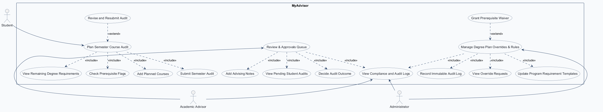
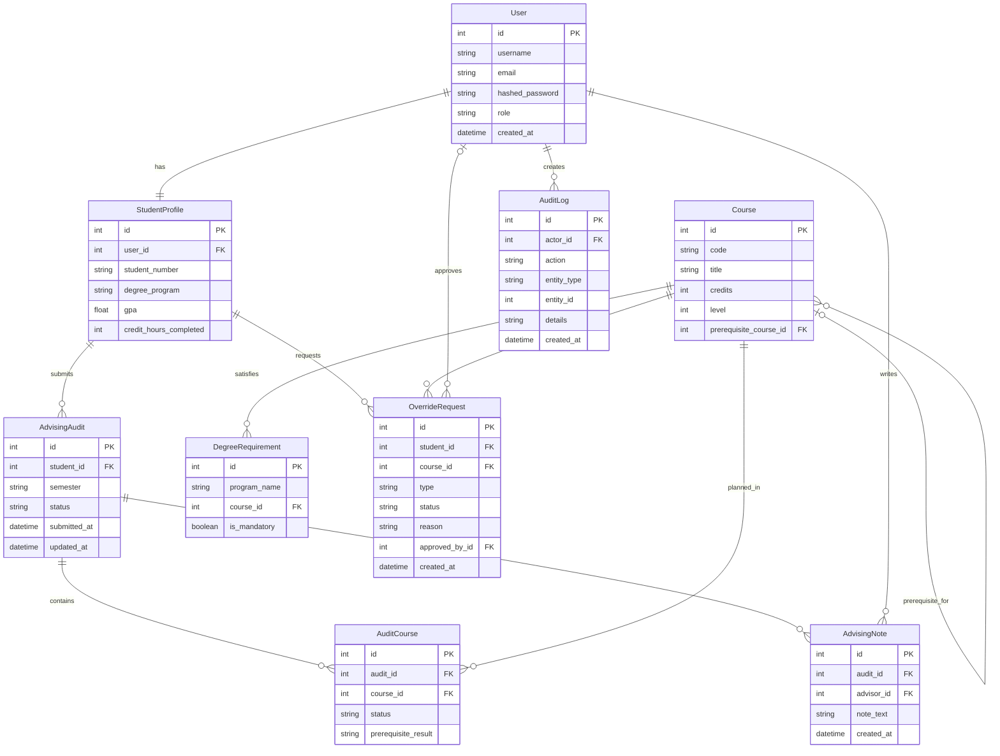
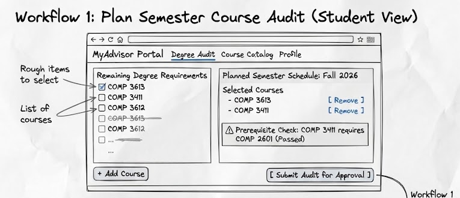
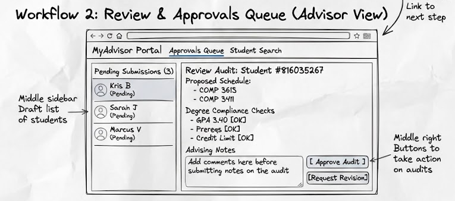
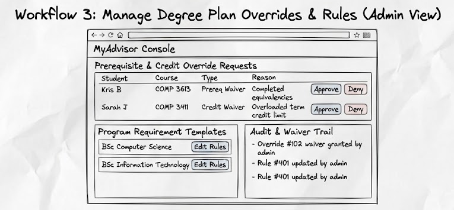

<!-- student-build:skill-integrity
status: pass
root: e84cd692d0b85eefe546385661958c27d07e8be6c5176a82012f68ccff5c8beb
expected_root: e84cd692d0b85eefe546385661958c27d07e8be6c5176a82012f68ccff5c8beb
mismatches: none
-->

# COMP 3613 Assignment 1

Draft this file with the Guide. **Update it after every phase milestone** before you pause. The use-case diagram is a UML PNG at `docs/diagrams/use-case.png`, linked from this file as `diagrams/use-case.png` (path relative to `docs/report.md`). The model diagram is Mermaid. **Embed wireframe images** as `wireframes/<file>` (files live in `docs/wireframes/`).

Do not put your student ID in this file if you will commit it. The PDF cover adds your name and ID at export time.

## Assigned project

MyAdvisor (Student Academic Advising Platform)

## Three workflows

### 1. Plan Semester Course Audit (Student)

A student views their remaining degree requirements, checks prerequisite flags, adds planned courses to their draft schedule, and submits the semester audit for approval. Done state: the schedule status updates to "Pending Approval" and appears in the advisor queue.

### 2. Review & Approvals Queue (Advisor)

An academic advisor views pending student audits, checks degree compliance logs, adds mandatory/optional advising notes, and approves or requests changes. Done state: the student's audit status updates to "Approved" or "Action Required" with timestamped logs.

### 3. Manage Degree Plan Overrides & Rules (Admin)

An administrator views edge-case credit override requests, grants prerequisite waivers, and updates program requirement templates. Done state: the system updates student eligibility records and records an immutable audit log entry.

## Use case diagram

Phase 2 structure: prerequisite checking, viewing requirements, adding planned courses, and submitting an audit are included in semester planning. Revising and resubmitting extends planning after an advisor requests changes. Granting a prerequisite waiver extends admin override and rule management. Academic advisors and administrators share viewing compliance and audit logs. The three actors are assumed to be authenticated role users through the starter application's existing auth flow.

## Model diagram

Phase 3 draft revised in Phase 4 from metadata visible in the wireframes. `StudentProfile.user_id` is the foreign key for the one-to-one profile. A student can have many semester audits, and audits and courses are many-to-many through `AuditCourse`. Each course has at most one prerequisite through the self-reference on `Course.prerequisite_course_id`. An audit can have many advising notes; advisor and approver references point to `User`. A course can appear in many degree requirements, and a student can have many override requests. The wireframes add prerequisite results, override type, and an immutable `AuditLog` for the admin audit and waiver trail.

## Wireframes

### Plan Semester Course Audit

The student dashboard shows the submitted audit as `Pending Approval` and locks editing. If an advisor requests revision, it changes to `Action Required`, displays the advisor notes, and exposes `Edit & Resubmit Audit`.

<!-- student-build:wireframe-coverage
use_case: Plan Semester Course Audit
image: docs/wireframes/workflow1-student-audit.png
covered: yes
-->

### Review & Approvals Queue

The advisor queue displays pending submissions, compliance checks, advising notes, and approval or revision actions.

<!-- student-build:wireframe-coverage
use_case: Review & Approvals Queue
image: docs/wireframes/workflow2-advisor-review.png
covered: yes
-->

### Manage Degree Plan Overrides & Rules

The admin view displays prerequisite and credit override requests, program requirement templates, and the audit and waiver trail.

<!-- student-build:wireframe-coverage
use_case: Manage Degree Plan Overrides & Rules
image: docs/wireframes/workflow3-admin-overrides.png
covered: yes
-->

Accepted model revisions from the wireframes:
- `AuditCourse.prerequisite_result` — prerequisite outcome shown beside selected courses.
- `OverrideRequest.type` — prerequisite waiver or credit waiver shown in the admin request table.
- `AuditLog` — immutable actor, action, entity, details, and timestamp trail shown in the admin view.

`python manage.py report` also embeds any PNG/JPG still missing from `docs/wireframes/`.

## Theming

- Colors: Deep Slate (`#1e293b`), Primary Indigo (`#4f46e5`), Light Canvas (`#f8fafc`)
- Type: Clean sans-serif using Inter/System UI
- Tone: Professional, academic, clean UI with clear status badges
- Wordmark: **MyAdvisor Portal**
- Applied to landing, login, register, and the authenticated shell in `app/static/css/app.css` and templates.

## Implementation notes

One named workflow at a time. Include verify notes and polish / model revisions (Phase 5). Do not treat the first build as final.

### Workflow 1 — Plan Semester Course Audit

- Implementation choice: one combined student workspace route at `/app/course-audit`.
- Layer scaffold: `app/routers/advising.py` → `app/services/advising_service.py` → `app/repositories/advising.py` → `app/models/advising.py`.
- The workspace loads the student's profile, degree courses, selected draft courses, and audit status through the service/repository layers. Submitting the form persists planned courses and changes the audit to `Pending Approval`.
- Verification feedback: bob initially had no profile, so `python manage.py init` now also seeds bob's profile, three default courses, and matching BSc Computer Science degree requirements. Student verified that courses display and submission changes the status badge to `Pending Approval`.
- Polish pass: the student chose visible prerequisite-result badges; the combined workspace now shows the stored `AuditCourse.prerequisite_result` beside each selected course and `Not checked` for courses not yet in the draft.

### Workflow 2 — Review & Approvals Queue

- Implementation choice: one combined advisor queue and inline review page at `/app/advisor/queue`.
- Student code-check snippets are scaffolded in `app/models/advising.py` and `app/routers/advising.py`.
- The advisor queue loads pending audits, course/prerequisite results, timestamped notes, and supports `Approved` or `Action Required` decisions through the service/repository layers.
- Verification feedback: student confirmed the queue, prerequisite review, advisor notes, and both approval/revision actions work as intended.
- Polish pass: the student chose a pending-audit count summary, now shown above the inline advisor queue.

### Workflow 3 — Manage Degree Plan Overrides & Rules

- Implementation choice: one combined admin console at `/admin/degree-plan`.
- Student code-check snippets are scaffolded in `app/models/advising.py` and `app/routers/advising.py`.
- The console supports degree requirement updates, prerequisite rule changes, pending override decisions, and immutable audit-log display through the service/repository layers.
- Verification feedback: student confirmed the admin console loads and degree requirement/prerequisite rule updates work. `python manage.py init` now also seeds one idempotent pending prerequisite-waiver request for the demo student so override management is visible.
- Polish pass: the student chose pending-override and recent-audit-entry summary cards above the admin management panels.
- Final verification feedback: student confirmed the seeded override request, summary cards, and requirement/prerequisite management panels display clearly after rerunning `python manage.py init`.

<!-- student-build:code-check
workflow: Manage Degree Plan Overrides & Rules
form: snippet
layer: model
architecture_ok: yes
implement_confidence: 0.90
passed: yes
note: Student completed OverrideRequest and AuditLog SQLModel fields from the ERD.
-->

<!-- student-build:code-check
workflow: Manage Degree Plan Overrides & Rules
form: snippet
layer: router
architecture_ok: yes
implement_confidence: 0.90
passed: yes
note: Student bound the admin console to user.id and the service; no persistence logic is in the route.
-->

<!-- student-build:code-check
workflow: Review & Approvals Queue
form: snippet
layer: model
architecture_ok: yes
implement_confidence: 0.90
passed: yes
note: Student completed the AdvisingNote SQLModel fields from the ERD.
-->

<!-- student-build:code-check
workflow: Review & Approvals Queue
form: snippet
layer: router
architecture_ok: yes
implement_confidence: 0.90
passed: yes
note: Student bound the advisor queue to user.id and the service; no persistence logic is in the route.
-->

<!-- student-build:code-check
workflow: Review & Approvals Queue
form: mcq
layer: service
architecture_ok: yes
implement_confidence: 0.90
passed: yes
note: Student selected the service layer to coordinate approval and revision decisions.
-->

<!-- student-build:code-check
workflow: Plan Semester Course Audit
form: snippet
layer: model
architecture_ok: yes
implement_confidence: 0.90
passed: yes
note: Student completed the SQLModel fields for the Workflow 1 ERD in app/models/advising.py.
-->

<!-- student-build:code-check
workflow: Plan Semester Course Audit
form: snippet
layer: router
architecture_ok: yes
implement_confidence: 0.90
passed: yes
note: Student bound the thin route to user.id and the AdvisingService; no persistence calls are in the router.
-->

## Deployed app

Phase 6. Public Render URL (not localhost). Markers open this to mark the three workflows.

https://faststarter-pgv4.onrender.com

## GitHub Repo

https://github.com/krisingh12/comp3613a1-myadvisor.git

## Logins

Every account a marker needs, including extra users you added. Starter accounts:

- bob / bobpass — regular user
- admin / adminpass — admin

## YouTube URL

https://youtu.be/lqfHwdz2qms

## Session transcripts

Filled when the Guide builds the report: the agent writes chat markdown into `docs/transcripts/`; `python manage.py report` packages them.

Guide packaged **1** chat(s) in `docs/transcripts/` (and `docs/transcripts.zip`).

Index: [docs/transcripts/INDEX.md](transcripts/INDEX.md)

- [`session1`](transcripts/session1.md)

## Competency (student-judge)

Filled by Guide from the student-judge run when this report was built.

**Judged at:** 2026-10-12T22:45:00-04:00  
**Evidence pass:** re-read accessible native Copilot chats, current `docs/report.md`, `docs/diagrams/`, `docs/wireframes/`, and refreshed `docs/transcripts/session1.md`; prior `judge.md` ignored

**Student / session:** Kristopher Boodoosingh / MyAdvisor  
**Artifact:** Four accessible Copilot Agent project sessions and `docs/transcripts/session1.md`  
**Phases in evidence:** 1–6 (COMP 3613; Phase 5 polish, Phase 6 deploy)

## Totals

| | Count / value |
|--|--|
| Metrics on rubric | 12 (M1–M12) |
| N/A (excluded) | 0 |
| Metrics scored | 12 |
| Scoreable max | 48 |
| Awarded total | 47 / 48 |
| **Overall (avg of scored)** | **3.9 / 4** |
| Impression mark | 19 / 20 |

## Scorecard

| ID | Metric | Score / 4 | In avg | Evidence |
|----|--------|----------:|:------:|----------|
| M1 | Phase discipline | 4 | yes | The sessions separate design phases, defer app code until wireframes, implement one workflow at a time, record verification and polish, then deploy. |
| M2 | Problem framing | 4 | yes | The student named MyAdvisor and three `Feature (user)` workflows, then supplied the entity/property list. Quote: “Workflows (exactly three): 1. Plan Semester Course Audit … 2. Review & Approvals Queue … 3. Manage Degree Plan Overrides & Rules …” |
| M3 | Decision ownership | 3 | yes | The student owned the workflows, model list, wireframe completion behavior, theming, and polish choices. Include/extend structure was mostly inferred by the Guide rather than answered in a separate student turn, so this is solid but not fully self-directed. |
| M4 | Artefact-before-code | 4 | yes | The UML use-case PNG, Mermaid ERD, three wireframes, and report notes precede the Phase 5 implementation. The implementation notes explicitly connect routers, services, repositories, and models to those artefacts. |
| M5 | Verification habit | 4 | yes | The report records observed results for all three workflows, including seeded data, status transitions, approval/revision actions, admin updates, and final summary-card verification. Quote: “student confirmed the seeded override request, summary cards, and requirement/prerequisite management panels display clearly.” |
| M6 | Assignment fit | 4 | yes | The final implementation follows the wireframes and ERD, reuses FastStarter auth, uses thin routes with service/repository layers, applies the requested theme, and records a completed Render deployment. |
| M7 | Slice explanation | 4 | yes | Each workflow has model and router code-check evidence with `architecture_ok: yes`; the report states routes call services without persistence logic and records the service-layer choice for approval/revision coordination. |
| M8 | Prompt quality | 4 | yes | Prompts are phase-tagged, use the required workflow format, provide wireframes at the correct phase, and include concrete deployment and verification requests. |
| M9 | Response to pushback | 4 | yes | The student addressed the missing profile/seed-data issue, chose prerequisite-result badges, chose queue and admin summary cards, and verified the resulting refinements instead of stopping at the first build. |
| M10 | Integrity | 4 | yes | The current report records skill-integrity `pass`; the accessible transcript contains no laundering flags, edited-skill evidence, or forced paste-back. |
| M11 | Provenance continuity | 4 | yes | The implementation and report consistently grow from the student’s MyAdvisor workflows, supplied entities, wireframes, status rules, and polish decisions. |
| M12 | Sincerity trajectory | 4 | yes | No suspicion blocks were needed; there is no abandonment or unresolved integrity spiral in the accessible project sessions. |

## Strengths

- Clear student-owned project framing with three complete workflows.
- Strong artefact continuity from use-case diagram and ERD through wireframes and implementation.
- Concrete verification and polish across all three workflows.
- Architecture-respecting model and thin-route snippets for every workflow.
- Phase 6 deployment evidence is recorded with a public URL and marker logins.

## Gaps (priority order)

1. Include/extend and shared-use-case decisions in Phase 2 were recorded primarily by the Guide after a concise prompt, so future work should make those relationship decisions explicit in the student’s own response.

## Phase gate status

| Phase | Status | Note |
|-------|--------|------|
| 1 | met | Project and three named workflows recorded. |
| 2 | met | Use-case PNG generated and included/extended/shared structure recorded. |
| 3 | met | Student supplied entities/properties and the ERD relationships were recorded. |
| 4 | met | All three wireframes were reviewed, coverage was complete, and the unclear submission/revision path was clarified. |
| 5 | met | Theme, one-workflow-at-a-time implementation, verification, and polish/model revisions are recorded. |
| 6 | met | Render URL is present in the report and marker logins are documented; deployment source is the pushed project. |

## Recommended next practice

- In the next design phase, answer the include/extend and shared-use-case prompts explicitly before the Guide drafts the diagram, using one short decision line per relationship.

## Integrity note

- Clean — no suspicion spiral, edited skills, or external-assist evidence was found in the accessible records.

## Provenance flags

- None.

## Sincerity log summary

- Blocks found: 0 | max round: 0 | min/mean/final confidence: N/A | trend: none | cleared: yes

## Skips

- Skips: 0/3 used. Skips are not an integrity failure.

## Skill integrity

Course skills are hashed at export and compared to `.agents/skills.lock.json`. Do not edit `.agents/skills/`, `.cursor/skills/`, or `AGENTS.md`.

- Status: **pass**
- Root: `e84cd692d0b85eefe546385661958c27d07e8be6c5176a82012f68ccff5c8beb`
- none
