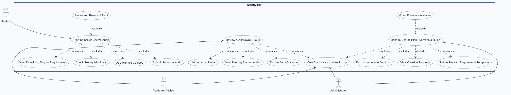
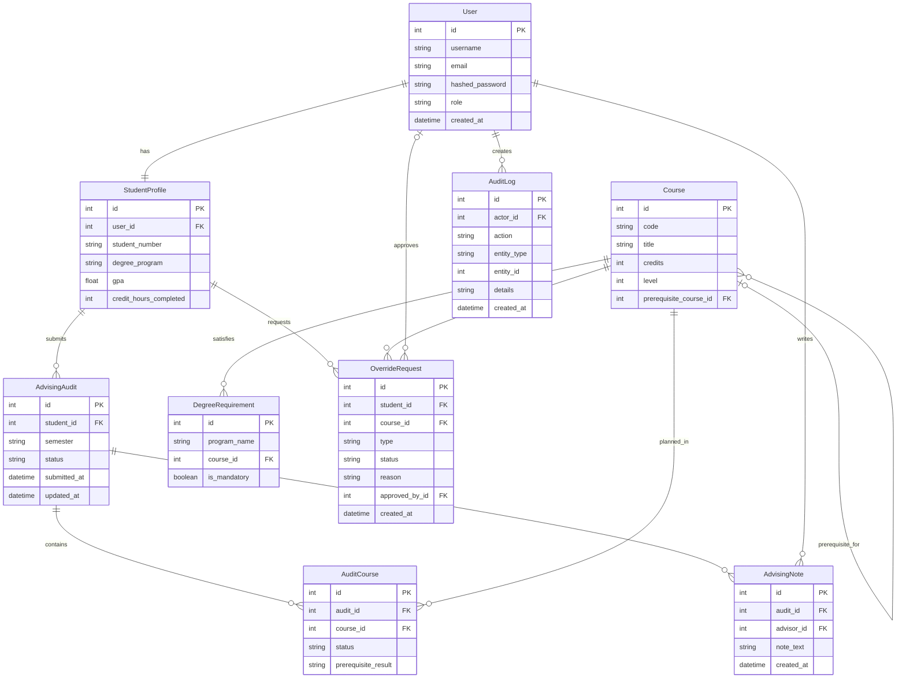
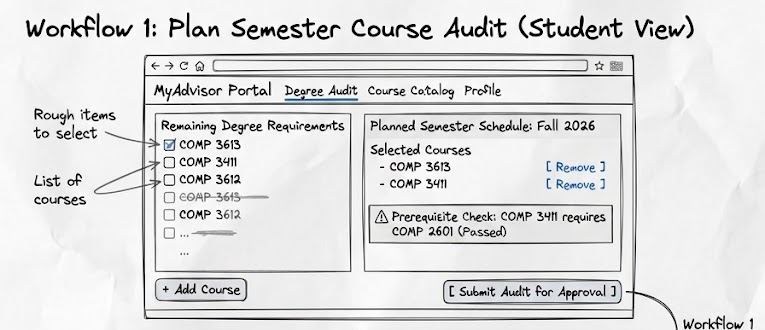
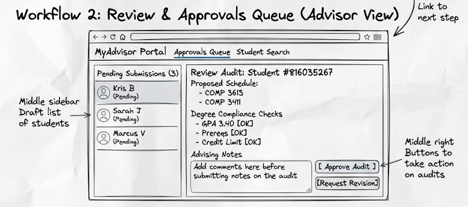
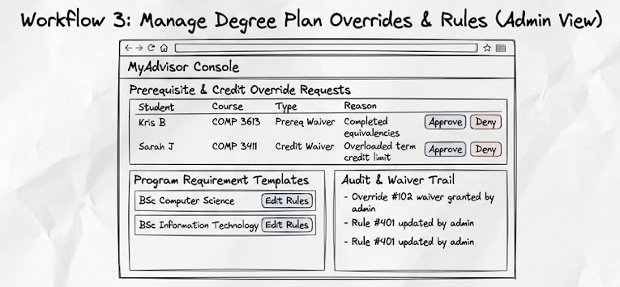

# COMP 3613 Assignment 1

Draft this file with the Guide. **Update it after every phase milestone** before you pause. The use-case diagram is a UML PNG at `docs/diagrams/use-case.png`, linked from this file as `diagrams/use-case.png` (path relative to `docs/report.md`). The model diagram is Mermaid. **Embed wireframe images** as `wireframes/<file>` (files live in `docs/wireframes/`).

Do not put your student ID in this file if you will commit it. The PDF cover adds your name and ID at export time.

## Assigned project

MyAdvisor (Student Academic Advising Platform)

## Three workflows

### 1. Plan Semester Course Audit (Student)

A student views their remaining degree requirements, checks prerequisite flags, adds planned courses to their draft schedule, and submits the semester audit for approval. Done state: the schedule status updates to "Pending Approval" and appears in the advisor queue.

### 2. Review & Approvals Queue (Advisor)

An academic advisor views pending student audits, checks degree compliance logs, adds mandatory/optional advising notes, and approves or requests changes. Done state: the student's audit status updates to "Approved" or "Action Required" with timestamped logs.

### 3. Manage Degree Plan Overrides & Rules (Admin)

An administrator views edge-case credit override requests, grants prerequisite waivers, and updates program requirement templates. Done state: the system updates student eligibility records and records an immutable audit log entry.

## Use case diagram

Phase 2 structure: prerequisite checking, viewing requirements, adding planned courses, and submitting an audit are included in semester planning. Revising and resubmitting extends planning after an advisor requests changes. Granting a prerequisite waiver extends admin override and rule management. Academic advisors and administrators share viewing compliance and audit logs. The three actors are assumed to be authenticated role users through the starter application's existing auth flow.

## Model diagram

Phase 3 draft revised in Phase 4 from metadata visible in the wireframes. `StudentProfile.user_id` is the foreign key for the one-to-one profile. A student can have many semester audits, and audits and courses are many-to-many through `AuditCourse`. Each course has at most one prerequisite through the self-reference on `Course.prerequisite_course_id`. An audit can have many advising notes; advisor and approver references point to `User`. A course can appear in many degree requirements, and a student can have many override requests. The wireframes add prerequisite results, override type, and an immutable `AuditLog` for the admin audit and waiver trail.

## Wireframes

### Plan Semester Course Audit

The student dashboard shows the submitted audit as `Pending Approval` and locks editing. If an advisor requests revision, it changes to `Action Required`, displays the advisor notes, and exposes `Edit & Resubmit Audit`.

<!-- student-build:wireframe-coverage
use_case: Plan Semester Course Audit
image: docs/wireframes/workflow1-student-audit.png
covered: yes
-->

### Review & Approvals Queue

The advisor queue displays pending submissions, compliance checks, advising notes, and approval or revision actions.

<!-- student-build:wireframe-coverage
use_case: Review & Approvals Queue
image: docs/wireframes/workflow2-advisor-review.png
covered: yes
-->

### Manage Degree Plan Overrides & Rules

The admin view displays prerequisite and credit override requests, program requirement templates, and the audit and waiver trail.

<!-- student-build:wireframe-coverage
use_case: Manage Degree Plan Overrides & Rules
image: docs/wireframes/workflow3-admin-overrides.png
covered: yes
-->

Accepted model revisions from the wireframes:
- `AuditCourse.prerequisite_result` — prerequisite outcome shown beside selected courses.
- `OverrideRequest.type` — prerequisite waiver or credit waiver shown in the admin request table.
- `AuditLog` — immutable actor, action, entity, details, and timestamp trail shown in the admin view.

`python manage.py report` also embeds any PNG/JPG still missing from `docs/wireframes/`.

## Theming

- Colors: Deep Slate (`#1e293b`), Primary Indigo (`#4f46e5`), Light Canvas (`#f8fafc`)
- Type: Clean sans-serif using Inter/System UI
- Tone: Professional, academic, clean UI with clear status badges
- Wordmark: **MyAdvisor Portal**
- Applied to landing, login, register, and the authenticated shell in `app/static/css/app.css` and templates.

## Implementation notes

One named workflow at a time. Include verify notes and polish / model revisions (Phase 5). Do not treat the first build as final.

### Workflow 1 — Plan Semester Course Audit

- Implementation choice: one combined student workspace route at `/app/course-audit`.
- Layer scaffold: `app/routers/advising.py` → `app/services/advising_service.py` → `app/repositories/advising.py` → `app/models/advising.py`.
- The workspace loads the student's profile, degree courses, selected draft courses, and audit status through the service/repository layers. Submitting the form persists planned courses and changes the audit to `Pending Approval`.
- Verification feedback: bob initially had no profile, so `python manage.py init` now also seeds bob's profile, three default courses, and matching BSc Computer Science degree requirements. Student verified that courses display and submission changes the status badge to `Pending Approval`.
- Polish pass: the student chose visible prerequisite-result badges; the combined workspace now shows the stored `AuditCourse.prerequisite_result` beside each selected course and `Not checked` for courses not yet in the draft.

### Workflow 2 — Review & Approvals Queue

- Implementation choice: one combined advisor queue and inline review page at `/app/advisor/queue`.
- Student code-check snippets are scaffolded in `app/models/advising.py` and `app/routers/advising.py`.
- The advisor queue loads pending audits, course/prerequisite results, timestamped notes, and supports `Approved` or `Action Required` decisions through the service/repository layers.
- Verification feedback: student confirmed the queue, prerequisite review, advisor notes, and both approval/revision actions work as intended.
- Polish pass: the student chose a pending-audit count summary, now shown above the inline advisor queue.

### Workflow 3 — Manage Degree Plan Overrides & Rules

- Implementation choice: one combined admin console at `/admin/degree-plan`.
- Student code-check snippets are scaffolded in `app/models/advising.py` and `app/routers/advising.py`.
- The console supports degree requirement updates, prerequisite rule changes, pending override decisions, and immutable audit-log display through the service/repository layers.
- Verification feedback: student confirmed the admin console loads and degree requirement/prerequisite rule updates work. `python manage.py init` now also seeds one idempotent pending prerequisite-waiver request for the demo student so override management is visible.
- Polish pass: the student chose pending-override and recent-audit-entry summary cards above the admin management panels.
- Final verification feedback: student confirmed the seeded override request, summary cards, and requirement/prerequisite management panels display clearly after rerunning `python manage.py init`.

<!-- student-build:code-check
workflow: Manage Degree Plan Overrides & Rules
form: snippet
layer: model
architecture_ok: yes
implement_confidence: 0.90
passed: yes
note: Student completed OverrideRequest and AuditLog SQLModel fields from the ERD.
-->

<!-- student-build:code-check
workflow: Manage Degree Plan Overrides & Rules
form: snippet
layer: router
architecture_ok: yes
implement_confidence: 0.90
passed: yes
note: Student bound the admin console to user.id and the service; no persistence logic is in the route.
-->

<!-- student-build:code-check
workflow: Review & Approvals Queue
form: snippet
layer: model
architecture_ok: yes
implement_confidence: 0.90
passed: yes
note: Student completed the AdvisingNote SQLModel fields from the ERD.
-->

<!-- student-build:code-check
workflow: Review & Approvals Queue
form: snippet
layer: router
architecture_ok: yes
implement_confidence: 0.90
passed: yes
note: Student bound the advisor queue to user.id and the service; no persistence logic is in the route.
-->

<!-- student-build:code-check
workflow: Review & Approvals Queue
form: mcq
layer: service
architecture_ok: yes
implement_confidence: 0.90
passed: yes
note: Student selected the service layer to coordinate approval and revision decisions.
-->

<!-- student-build:code-check
workflow: Plan Semester Course Audit
form: snippet
layer: model
architecture_ok: yes
implement_confidence: 0.90
passed: yes
note: Student completed the SQLModel fields for the Workflow 1 ERD in app/models/advising.py.
-->

<!-- student-build:code-check
workflow: Plan Semester Course Audit
form: snippet
layer: router
architecture_ok: yes
implement_confidence: 0.90
passed: yes
note: Student bound the thin route to user.id and the AdvisingService; no persistence calls are in the router.
-->

## Deployed app

Phase 6. Public Render URL (not localhost). Markers open this to mark the three workflows.

https://

## Logins

Every account a marker needs, including extra users you added. Starter accounts:

- bob / bobpass — regular user
- admin / adminpass — admin

## YouTube URL

## Session transcripts

Filled when the Guide builds the report: the agent writes each Guide chat to `docs/transcripts/<slug>.md` (Copilot Agent, Cursor, or OpenCode). `python manage.py report` packages them. Do not paste chats here during the build.

## Competency (student-judge)

Filled when the report is built. Guide runs student-judge, writes `docs/judge.md`, and export appends the scorecard here.

## Skill integrity

Filled by `python manage.py report`. Do not edit the course skills.
